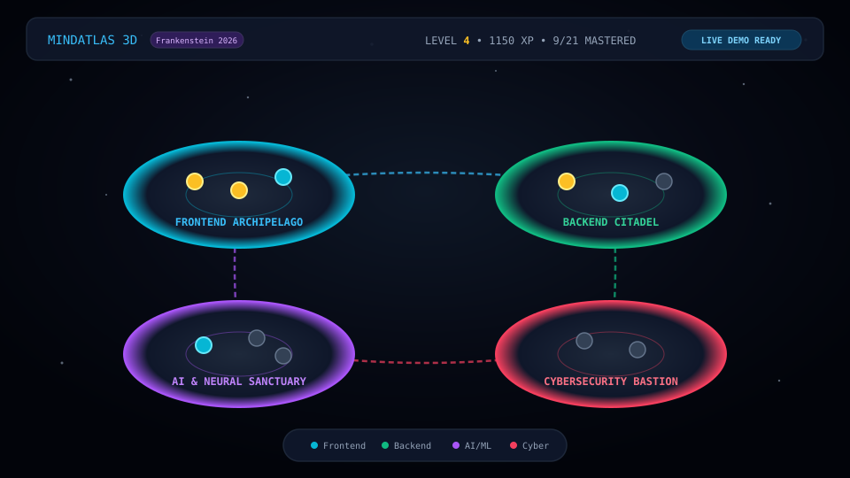
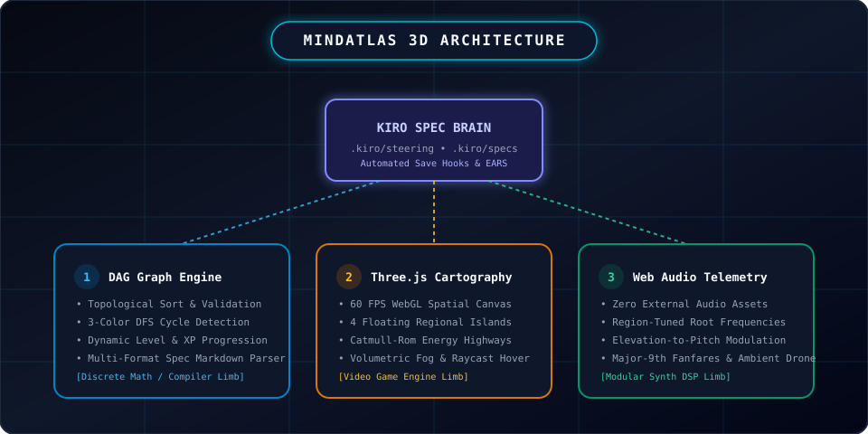

# MindAtlas 3D (SpatialQuest 3D)

[](https://chiru534.github.io/mindatlas-3d/)
[](https://devpost.com)
[](tsconfig.json)
[](src/services/questGraphEngine.test.ts)
[](LICENSE)

> **Live Interactive WebGL App:** [https://chiru534.github.io/mindatlas-3d/](https://chiru534.github.io/mindatlas-3d/)  
> **Source Repository:** [https://github.com/Chiru534/mindatlas-3d](https://github.com/Chiru534/mindatlas-3d)  
> **Submission Category:** Kiroween Hackathon — Frankenstein Track  
> **Author:** Chiru534 ([Devpost Profile](https://devpost.com/Chiru534))  

---



---

## 1. Executive Summary & The Frankenstein Metaphor

Traditional syllabus outlines, learning roadmaps, and curriculum trackers are flat, sterile, and demotivating. Text bullet points fail to convey dependency hierarchy, spatial relationship, or momentum.

**MindAtlas 3D** transforms flat course syllabi into an explorable **Interstellar Planetary Galaxy System**. Subject domains become radiant star systems centered on luminous galactic suns, while individual lessons and modules orbit as textured 3D celestial planets with orbiting satellite moonlets for subtasks. Clearing prerequisites sends traveling photonic comets along interstellar warp conduits, de-cloaks cryo-stasis containment shields, terraforms barren worlds, and triggers procedural acoustic telemetry synthesized live in the browser.

To solve the dual demands of **visual spectacle** and **pedagogical clarity**, MindAtlas 3D provides a seamless **Dual-Mode Architecture**:
1. **`[ 🌌 3D Cosmic Galaxy ]`**: An immersive 60 FPS WebGL universe with orbital Keplerian tracks, planetary rings, warp conduits, and cinematic fly-to navigation.
2. **`[ 📋 Structured Syllabus Outline ]`**: A clean, accessible curriculum roadmap with numbered steps (`01`, `02`...), module progress bars, subtask checklists, and direct 3D warp triggers.

### The Three Stitched Limbs of the Chimera

MindAtlas 3D deliberately stitches together three radically different computational domains:



| Body Part | Technical Paradigm | Library / Stack | Role in MindAtlas 3D |
| :--- | :--- | :--- | :--- |
| **The Skeleton** | Discrete Graph Theory & Formal Compilers | Pure TypeScript Engine | Directed Acyclic Graph (DAG) with 3-color DFS cycle detection, topological ordering, and cascading status unlock propagation. |
| **The Flesh & Eyes** | 3D Spatial Planetary WebGL Engine | Three.js WebGL + UnrealBloomPass HDR | 60 FPS cosmic universe with galactic star systems, textured 3D planets, Keplerian orbital rings, orbiting satellite moonlets, and interstellar warp conduits. |
| **The Voice & Pulse** | Modular Acoustic DSP Synthesis | Browser Web Audio API (`AudioContext`) | 100% zero-asset procedural sound generation: sector-tuned harmonic roots, elevation-to-pitch scaling, major-9th unlock fanfares, and an ethereal 55Hz space drone. |
| **The Brain** | Spec-Driven Agent Architecture | Kiro (`.kiro/steering/`, `.kiro/specs/`, `.kiro/hooks/`) | Formal EARS requirements, architectural designs, phased task contracts, and automated pre-save validation hooks. |

---

## 2. Kiro Spec-Driven Engineering Workflow

MindAtlas 3D was conceived, specified, and implemented under the **Kiro Spec-Driven Architecture**. The complete specification tree is checked into the repository:

```
.kiro/
├── steering/
│   └── frankenstein-rules.md     # Architectural constraints: zero `any`, Three.js memory hygiene, zero external audio
├── specs/
│   └── mind-atlas-3d/
│       ├── requirements.md       # Formal EARS requirements (Ubiquitous, Event-driven, State-driven)
│       ├── design.md             # Data models, mathematical formulas, camera projections, audio tables
│       └── tasks.md              # Phased, trackable implementation checklists (Tasks 1 through 6)
└── hooks/
    └── quest-spec-validator.json # Pre-save agent hook enforcing strict types and memory disposal
```

### Architectural Guardrails from `.kiro/steering/frankenstein-rules.md`:
1. **Zero `any` Policy:** Every component, hook, geometry buffer, and audio node is strictly typed with TypeScript interfaces.
2. **Deterministic Memory Disposal:** All Three.js meshes, materials, canvas textures, and WebGL render targets implement comprehensive disposal traversals inside `useEffect` cleanup routines to prevent memory leaks.
3. **Pure DSP Audio (Zero External Assets):** No `.mp3`, `.wav`, or `.ogg` audio files are permitted. All acoustic feedback is generated by pure trigonometric waveforms and gain envelope scheduling.

---

## 3. Core Features & User Workflows

### 3.1 Planetary Galaxy 3D Engine & Space Navigation
- **Galactic Star Systems:** Each subject domain is anchored by a central radiant star with coronal flare auras, rotating accretion discs, and point lights.
- **3D Celestial Planets:** Lessons are rendered as 3D planets with Keplerian orbit tracks:
  - *TERRAFORMED (Completed):* Living emerald/golden world with Saturn-like rings, ascending sky beacon spire, and swirling golden stardust motes.
  - *ACTIVE ORBIT (Unlocked):* Bioluminescent planet with active tectonic grid, equator telemetry ring, and 4 orbiting telemetry satellites.
  - *IN STASIS (Locked):* Obsidian cryo-planet enveloped in a pulsating geodesic hex-stasis shield with crimson containment lasers.
- **Subtask Moonlet Satellites:** Learning objectives orbit their parent planet as miniature moons, glowing emerald when completed.
- **Interstellar Warp Conduits:** Translucent glass warp tubes carrying directional photonic comets from parent to dependent planets.
- **Mission Compass HUD:** Persistent mission card pointing directly to your next objective with 1-click warp flight.

### 3.2 Dual-Mode Syllabus Outline View
- Instant 1-click toggle between `[ 🌌 3D Cosmos ]` and `[ 📋 Syllabus Outline ]`.
- Sequential curriculum layout organized by sector/subject with step numbers (`#01`, `#02`...), subtask checkboxes, and in-place notes.
- "Warp in 3D" button on every module smoothly switches into 3D and swoops the camera into an orbital close-up of that planet.

### 3.2 Dual-Format Markdown Spec Importer (v2)
- Imports external syllabi, roadmaps, or curriculum documents into physical 3D terrain.
- **Supported Formats:**
  - **Section Format:** `## Landmark Title` with bulleted metadata (`- Region: Frontend Archipelago`, `- Prerequisites: HTML Foundations`, `- XP: 100`). Correctly handles comma-bearing titles.
  - **Hierarchical Outline Format:** `# Region` followed by `- [ ] Task Title` markdown checklist items.
- **Import Target Modes:**
  - **Replace World (Clean Slate):** Wipes existing territory, recalculates baseline levels, and centers the camera exclusively on imported regions.
  - **Merge with Current Map:** Seamlessly grafts new landmarks into the existing archipelago and establishes inter-island road highways.
- **Curated One-Click Presets:**
  - *Full-Stack Web Architect* (Frontend + Backend curriculum)
  - *AI & Neural Systems Specialist* (Deep Learning, Transformers, Multi-Agent Swarms)
  - *Cybersecurity Bastion & Hardening* (PKI, Zero-Trust, Network Hardening)

### 3.3 Milestone Sub-Tasks & Note Persistence
- **Milestone Checklist:** Sub-tasks can be checked off inside the inspector drawer and persist across browser reloads via `localStorage`.
- **In-Place Markdown Notes:** Direct study notes and architectural specifications can be edited and saved per landmark.
- **Safe Recalculation:** Player level and XP progression are always recalculated deterministically from completed landmarks, preventing stale client state.

### 3.4 Procedural Web Audio Engine
- **Region-Specific Harmonic Roots:**
  - *Frontend Archipelago:* C5 ($523.25\text{ Hz}$)
  - *Backend Citadel:* A4 ($440.00\text{ Hz}$)
  - *AI & Neural Sanctuary:* E5 ($659.25\text{ Hz}$)
  - *Cybersecurity Bastion:* G4 ($392.00\text{ Hz}$)
- **Elevation Modulation:** Landmark Y-coordinates modulate the carrier frequency, providing spatial height telemetry.
- **Triumphant Fanfares:** Clearing quests triggers a 4-chord major-9th arpeggiated fanfare with exponential gain decay.
- **Ethereal Space Drone:** Continuous 55Hz sub-bass ambient drone modulated by a $0.08\text{ Hz}$ LFO.

---

## 4. Technical Verification & Architecture Proof

| Requirement | Implementation Evidence | Verification Method |
| :--- | :--- | :--- |
| **Directed Acyclic Graph** | `src/services/questGraphEngine.ts` implements topological sorting and 3-color DFS cycle prevention. | `npm test` (`questGraphEngine.test.ts` passes 5/5 assertions) |
| **Markdown Import Resilience** | `src/services/markdownQuestParser.ts` parses both section and hierarchical formats, preserving comma-separated titles. | `npm test` (`markdownQuestParser.test.ts` passes 2/2 assertions) |
| **Zero Memory Leaks** | `src/components/AtlasCanvas3D.tsx` traverses and disposes of all `BufferGeometry`, `Material`, textures, and OrbitControls on unmount. | Code review & React 19 StrictMode mounting validation |
| **Production Bundle Optimization** | `vite.config.ts` configures Rollup manualChunks (`vendor-three`, `vendor-react`, `vendor-icons`). | `npm run build` generates clean chunks under 550KB with zero warnings |
| **Live Web Deployment** | Built via GitHub Actions with relative path resolution (`base: './'`). | Hosted on GitHub Pages: [https://chiru534.github.io/mindatlas-3d/](https://chiru534.github.io/mindatlas-3d/) |

---

## 5. Local Development & Build Instructions

### Prerequisites
- Node.js $\ge 18.0.0$
- npm $\ge 9.0.0$

### 1. Clone & Install
```bash
git clone https://github.com/Chiru534/mindatlas-3d.git
cd mindatlas-3d
npm install
```

### 2. Start Development Server
```bash
npm run dev
```
Open `http://localhost:3000` in any modern WebGL-capable browser.

### 3. Run Automated Tests
```bash
npm test
```
Runs the Vitest suite against the DAG engine and markdown parser.

### 4. Production Build
```bash
npm run build
```
Generates production-optimized static assets in `dist/`.

---

## 6. License

This project is open-source under the [MIT License](LICENSE).  
Copyright (c) 2026 Chiru534.
